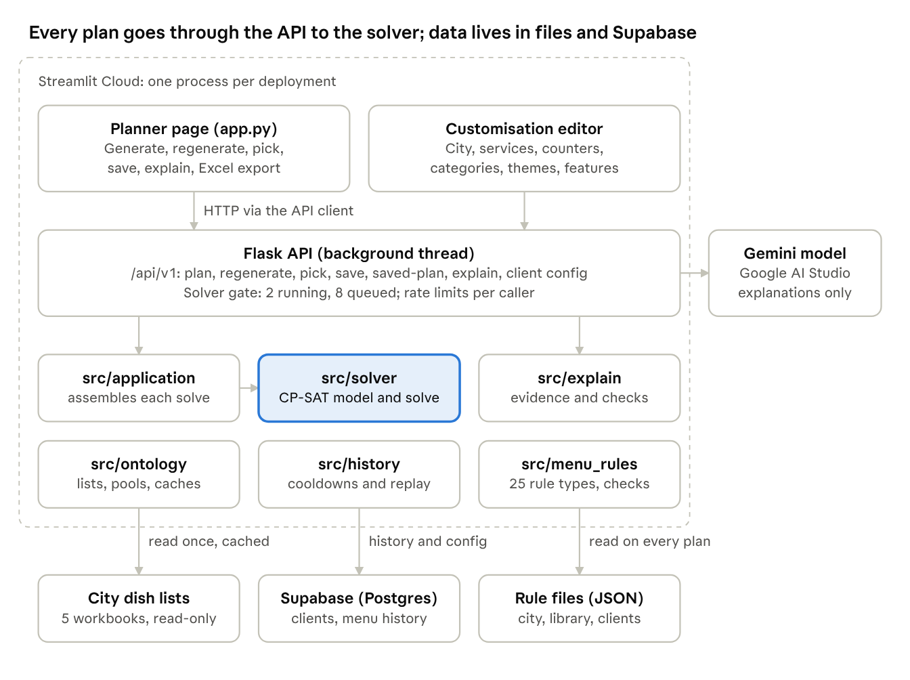

# Ikigai Masala Menu Planner — Product and Engineering Guide

Last updated: 24 Nov 2026

## Why the tool exists

Menus used to be planned by hand, which was slow, repetitive work and depended on what the planner remembered. Ikigai Masala turns every site's rules and serving history into a plan the computer checks completely, every week.

**The problems with planning by hand**

- **Hard, repetitive work.** Every site needs a fresh week: 10–15 categories a day, 5–7 days, for every service and counter, at 66 sites, every week.
- **Rules get missed.** A Bangalore site carries 67 city rules plus its own: paneer at most twice, biryani only on Wednesday, raita with a pulao, no kheer at Corning Chakan. Nobody can check them all by hand on every menu.
- **Old menus come back.** A dish, or the whole of week 1, reappears in week 3 or 4 because no one remembers what was served. Checking history by hand rarely happens.
- **Variety is hard to balance.** Colours, key ingredients, cuisines and textures have to vary across each plate and across the week at the same time.
- **Results vary by planner.** Two people planning the same site make different trade-offs, and site rules live in their heads.

**What the tool does instead**

- Each rule is written once, as data, and checked on every plan.
- It remembers what was served: a dish waits 21 days before it returns, and a saved week cannot repeat within 30 days.
- It plans a full week for every service and counter in minutes.
- It says when a rule could not be fully met, and why.
- The chef stays in charge: any cell can be regenerated or replaced by hand.

## 1. What the tool is

Ikigai Masala plans a week of menus for each corporate kitchen (a "client") from its city's dish list. It uses Google OR-Tools CP-SAT to pick one dish per cell so that every rule holds at once. The code lives in `darshancmpawar/Menu_Engineering_App`, package `ikigai_masala-main`.

**Scale as of 23 Nov 2026**

| City | Clients | Dishes in list | Services in list |
| --- | --- | --- | --- |
| Bangalore | 46 | 5,817 | lunch/dinner 5,408 · breakfast 409 |
| Hyderabad | 0 | 5,699 | lunch/dinner |
| Pune | 4 | 1,342 | lunch/dinner 1,303 · breakfast 24 · snacks 14 · both 1 |
| NCR | 8 | 1,235 | lunch/dinner |
| Chennai | 8 | 656 | lunch/dinner |

Client counts come from the live `clients` table export of 23 Nov; dish counts from `data/raw/city_items/<city>.xlsx` on `main`.

**Key features**

| Feature | What it does |
| --- | --- |
| Weekly plan | One menu per day for 5 weekdays (or 7 with weekends), per counter, per service |
| Four services | Lunch, dinner, breakfast and evening snacks, each with its own counters |
| Counters | A client can run several stations, each with its own categories, item counts and day themes |
| Day themes | Each weekday carries a theme (mix, north, south, chinese, biryani and others) that steers cuisine |
| Three rule layers | Global rule library, city rules, then client rules; a client can disable or override any |
| Cooldowns | A dish waits 21 days by default before it returns (most live clients are set to 20); rice and bread have a 10-day gap; a whole week cannot repeat within 30 days |
| Regional days | A lunch or dinner can be built around one Indian region's dishes |
| Regenerate | Re-solve only the cells the chef selects, keeping the rest locked |
| Explanations | "Explain this menu" describes each day; "Ask the chef" adds a model's judgement of it |
| Relaxation reporting | When a rule had to bend to find a menu, the screen says which rule and why |
| Customisation editor | A step-by-step editor for a client's city, services, counters, categories, themes and item pools |
| Excel export | The planned week exported in the kitchen's sheet layout |

## 2. System architecture

The tool is one Streamlit process on Streamlit Cloud. The Streamlit page starts a Flask API in a background thread, and every plan, save and config change goes through that API to the domain code in `src/` and to Supabase (Postgres). Dish lists and rules are files in the repository; history and client settings live in Supabase.

The API thread keeps the dish lists and city rules it loaded for the life of the process; client rule files and Supabase are read on every plan. So only a dish-list or code change needs a reboot.

### 2.1 Deployment

- **Entry point:** `ikigai_masala-main/app.py`, run by Streamlit Cloud with `requirements.txt`. There is no Dockerfile or Procfile.
- **Backend:** `_ensure_backend_running` probes ports 5000–5004. If no healthy backend answers, it starts `api.app` with Flask's threaded server in a daemon thread, once per process.
- **Secrets:** `SUPABASE_URL` and `SUPABASE_KEY` (the service-role key) are required; the app stops at start-up without them. Optional settings cover the time zone, write token, data paths, seasonal bans and the explanation model.
- **Database schema:** applied by hand from `scripts/setup_all.sql` in the Supabase SQL editor.

### 2.2 Components

| Layer | Component | Responsibility |
| --- | --- | --- |
| UI | Planner page (`app.py`) | Sidebar (client, dates, services, features); Generate, Save, Excel, Regenerate, Pick, Explain, seasonal and regional panels |
| UI | Customisation editor (`customisation/`) | Step-by-step client setup: city, services, counters, categories, themes, pools, features |
| UI | API client (`ui/api_client.py`) | HTTP wrapper; one retry on 429/502/503/504 honouring `Retry-After` (max 5 s); typed errors |
| UI | Helpers (`ui/`) | Plan blocks, interactive menu table, Excel export, shared-item and meal-difference helpers |
| API | Flask app (`api/app.py`) | 18 routes under `/api/v1`; request IDs; 2 MB body cap; optional write token |
| API | Solver gate (`api/concurrency.py`) | At most 2 solves at once, a queue of 8, 300 s queue timeout |
| API | Rate limiter (`api/rate_limit.py`) | In-memory token buckets per caller |
| API | Explanation model (`api/explain_llm.py`, `api/kitchen_notes_llm.py`) | Gemini prose, the chef's read, seasonal kitchen notes |
| Domain | `src/application` | Assembles one solve: rules, pins, history, bans, solver settings |
| Domain | `src/solver` | CP-SAT model and solve, regenerate, pick and audit, output formatting |
| Domain | `src/menu_rules` | Rule loading and merging, the 25 rule types, pre-flight diagnostics, relaxation reporting |
| Domain | `src/preprocessor` | Workbook rows → cleaned table → one candidate pool per slot |
| Domain | `src/ontology` | City-to-file lookup; cached tables, pools, rules and regions |
| Domain | `src/history` | Cooldown bans, freshness, week signatures, save and replay |
| Domain | `src/client` | Client config reads and atomic writes; at most 6 counters |
| Domain | `src/explain` | Evidence, checks, pairings and fallback prose; no network |
| Domain | `src/seasonal` | Monthly red and yellow vegetable lists per region |
| Data | `data/raw/city_items/*.xlsx` | The five city dish lists (read-only to the app) |
| Data | `data/configs/` and `customisation/client rules/` | City rulesets, rule library, seasonal lists, 54 client rule files |

A test (`tests/platform/test_architecture.py`) enforces the layering: `src/` may not import `api`, `ui`, `customisation`, `streamlit` or `flask`.

### 2.3 API endpoints

| Method | Path | Purpose |
| --- | --- | --- |
| POST | `/plan` | Solve one counter for one service (rate limit 18/min, solver gate) |
| POST | `/regenerate` | Re-solve the selected cells (20/min, solver gate) |
| POST | `/pick` | Put a dish the chef named into a cell, then audit it (20/min) |
| POST | `/save` | Write the week to history (write bucket, optional token) |
| GET | `/saved-plan` | Replay a saved week |
| POST | `/explain` | Explain an existing plan; never solves |
| POST | `/seasonal-bans` | The month's red and yellow vegetables, with kitchen notes |
| POST | `/diagnose` | Pre-flight only (no UI caller) |
| GET | `/regions` | Regions a city can theme a day with, with slot depth |
| POST | `/pool-preview` | Item-pool counts for the editor |
| GET | `/editor-metadata` | Slot lists, themes, cities and pools for the editor |
| GET / PUT | `/client-config/<name>` | Read a client's config (with ETag) / update it atomically (version check, 409 on conflict) |
| POST / DELETE | `/client`, `/client/<name>` | Create / delete a client (history goes with it) |
| GET | `/clients` | List clients with city |
| GET | `/health`, `/metrics` | Liveness with Supabase and queue status; counters |

All paths are under `/api/v1`. Errors carry a request ID but never exception text; 429 carries `Retry-After`.

### 2.4 Concurrency and caching

- **Solver gate.** Only `/plan` and `/regenerate` are gated: 2 running, 8 queued, 503 when the queue is full, 504 after 300 s waiting.
- **Workers.** CP-SAT runs with 1 worker in production, because the solver is deterministic by default. The 9/5-worker table in `api/concurrency.py` is passed in but not used.
- **Time budget.** The planner sends 180 s split across counters (at least 45 s each); the API accepts 10–600 s.
- **Process caches** (`OntologyRepository`): city tables, pools per service, rules per city, non-veg names and regions are cached for the life of the process. Supabase config and history, client rule files and the rule library are read fresh on every call.
- **Streamlit caches:** client lists and settings for 60 s, regions for 300 s.

**Reboot after a data or code change.** The API thread starts once per process and keeps its imports and caches. After a merge, Streamlit reruns the page, finds the old backend healthy and reuses it, so new dish lists, city rules and API code are not seen until the app is rebooted on Streamlit Cloud (Manage app → ⋮ → Reboot app).

## 3. Data model

Three kinds of data drive a plan: the city dish list (one Excel workbook per city, 144 columns), the rule files (JSON in the repository), and four Supabase tables that hold client settings and served history.

### 3.1 City dish lists

Each workbook in `data/raw/city_items/` has one sheet: 31 descriptive columns and 113 `is_*` flags. Nothing in the app writes to them.

| Column | How the code uses it |
| --- | --- |
| `item_id` | Unique key; duplicates are dropped |
| `item` | Canonical lower-case dish name; stored in history and matched by the cooldown |
| `course_type` | Decides the slot a dish can fill (1:1 map; `sambar/rasam` split by name) |
| `category` | Builds the Accompaniments pool; part of the effective key ingredient |
| `sub_category` | Selectors and per-client slot moves |
| `primary_protein`, `is_egg_dish` | The vegetarian line: non-veg dishes are kept out of every veg slot |
| `key_ingredient` | Ingredient bans, attribute grouping, seasonal matching |
| `cuisine_family` | Theme filter (south Indian, north Indian, chinese, continental) |
| `item_color` | Colour constraints and the colour suffix shown on screen |
| `client` | Comma-separated item-pool tokens (unused while every city is full-pool) |
| `session` | Which services the dish serves: `lunch,dinner`, `breakfast`, `snacks` or a combination |
| `state_origin`, `admin_type` | Regional days |
| `spice_level`, `texture`, `richness_score` | Explanation checks, pairings, the chef's read; texture also in plate-variety rules |
| `item_style`, `drink_rule_group` | Drink rules |
| `is_*` flags | Rule selectors (for example `is_premium_gravy`, `is_liquid_dessert`, `is_rice_bread`) |

### 3.2 From rows to slot pools

1. **Load and clean** (cached per workbook): read sheet 0, rename alias columns, lower-case text, set blank colour to `unknown`, coerce flags to 0/1, drop rows without `item` or `course_type`, de-duplicate on `item_id`.
2. **Service filter:** keep rows whose `session` names the service being planned.
3. **Pools** (`PoolBuilder.build_pools`): one pool per slot from `course_type`; Accompaniments from `category`; plain curd and curd rice from their flags; combination slots as the union of two pools; non-veg dishes only in non-veg slots. An empty required slot raises an error (required slots per city come from `ontology_categories.json`; breakfast and snacks have none).
4. **Client item pools:** a city not in `FULL_POOL_CITIES` would narrow to `common` plus the client's `source_pools`. All five cities are in that set today, so every client sees its whole city list.
5. **Slot moves:** a client file can move a sub-category into another slot (for example kootu into veg dry for Rippling).
6. **Per day:** the pre-filters and sampling described in section 5.

### 3.3 Supabase tables

| Table | Columns | Key |
| --- | --- | --- |
| `clients` | `name`, `version`, `counters` (JSON), `city`, `meals`, `serve_weekends`, `working_days`, `item_cooldown_days`, `source_pools`, `shared_categories`, `region_map`, `features`, `is_launch_site`, `created_at` | `name` |
| `menu_history` | `client_name`, `service_date`, `meal`, `menu` (JSON), `region`, `created_at` | (`client_name`, `service_date`, `meal`); cascades on client delete |
| `week_signatures` | `id`, `client_name`, `week_start`, `week_signature`, `meal`, `created_at` | unique (`client_name`, `week_start`, `week_signature`) |
| `app_settings` | `key`, `value` (JSON) | `key`; the code reads `core_min_one_slots` |

Row-level security is on with allow-all policies, so the service-role key is required. A saved `menu` is `{slot_id: dish}` for a single counter and `{counter: {slot_id: dish}}` for several.

### 3.4 The client config

A client's settings are split between its database row and its rule file.

**Database row**

- `counters`: an ordered list of `{name, categories, slot_counts, theme_map, meals?}`. Each category count is 1–5; at most 6 counters. A counter tagged with `meals` serves only those services; an untagged one serves all.
- `city`: Bangalore, Chennai, Hyderabad, NCR or Pune (empty reads Bangalore).
- `meals`: the services served, in eating order; default lunch and dinner.
- `serve_weekends`, `working_days`, `item_cooldown_days` (empty = 21; read clamped to 0–60).
- `shared_categories`, `region_map` (weekday → region), `source_pools`, `is_launch_site`.
- `features`: `regional_days`, `explain_menu`, `ask_chef`, `banned_vegetables`, `veg_markers`, `last_served`; all off by default.
- `version`: incremented on every write; a PUT with an old version gets 409.

**Rule file** (`customisation/client rules/<client>.json`; the client name inside the file must match `clients.name` exactly)

| Key | Meaning |
| --- | --- |
| `rules` | The client's own rules |
| `disable` | City rules to drop, by name |
| `use` | Library components to include, with optional overrides |
| `constant_items`, `constant_items_by_meal` | Pins: a fixed dish or text in a slot, for all services or per service |
| `combo_majority`, `combo_by_theme` | Which half a combination slot serves |
| `counters` | Per-counter rules and pins |
| `display` | Row order and labels on screen and in Excel, per service |
| `shared_categories`, `shared_categories_excluded_counters` | Categories every counter shares with counter 1 |
| `meal_shared_categories` | Categories a later service copies from the first ("same as lunch") |
| `slot_pool_moves` | Move a sub-category into another slot's pool |

## 4. Planning pipeline

Generate replays a saved week if one exists; otherwise it solves each service in eating order (breakfast, lunch, snacks, dinner) and each counter in order, passing dishes forward so later counters and services stay consistent. Save writes the week to history, and history then drives the cooldowns of every later plan.

### 4.1 Generate

1. **Read config.** The planner reads the client's counters per service, city and shared categories (`GET /client-config`).
2. **Time budget.** 180 s split across all counters of the selected services, at least 45 s each.
3. **Saved week?** For single-counter clients only, the planner asks `/saved-plan` for every selected service. If every served date from today onward is saved, the saved week is shown ("Loaded from history") and nothing is solved. Multi-counter clients always re-solve.
4. **Solve per service and counter.** One `POST /plan` per counter, in order. On the server:
   1. Inputs are assembled: city pools, slot moves, working days, rules (city → client → library → regional → seasonal), pins, history bans, solver settings.
   2. Pre-flight: every rule's `diagnose()` runs; any error returns HTTP 422 and the block shows the blocked rules with suggestions.
   3. The solve runs as in section 5, inside the relaxation capture. If it fails and dishes were shared from counter 1, it retries once without them and adds a warning.
   4. The response holds the whole horizon (non-working days blank), diagnostics, relaxations and region information. A solver failure returns 500 with the tightest slots.
5. **Show.** Each service is a stacked section of plan blocks, one per counter.

### 4.2 How counters and services pass dishes forward

- **Shared categories (across counters).** Counter 1 is solved first. Its dishes in the shared categories are pinned into every later counter, unless that counter is listed as excluded. A client's own pin wins.
- **No repeats (across services).** After each service, every dish it served is sent to the next service as `exclude_items` and folded into the history bans. Staples, repeatable slots and cooldown-exempt slots may still repeat.
- **Same as lunch.** `meal_shared_categories` copies the first service's dish into later services for named categories (for example Corning Chakan), and keeps it out of the exclusion.
- **Meal difference.** Reported, not enforced: days where a service differs from the previous one by less than 35% are listed in a warning.
- **Rule scope.** A rule can carry `meals` to apply only to some services; regional days apply to lunch and dinner only.

### 4.3 Regenerate and Pick

**Regenerate** re-solves only the cells the chef selected.

1. The planner sends the current plan, the cells to replace and every dish already shown for those cells.
2. The server rejects a pinned cell (400), locks every other cell, and forbids the old and already-seen dishes.
3. If that is infeasible, it retries with a −270,000 penalty on the old dish instead of a ban.
4. Regenerate does not capture relaxations, so after it the explanation still shows the original plan's relaxations.

**Pick** puts a dish the chef names into a cell without solving. It refuses a pinned cell, a dish that is not in that slot's city list, or a dish already used in the same ISO week. It then warns about any rule the dish breaks: cooldown, rice-bread gap, any pre-filter, plate checks.

### 4.4 Save and export

- **Save** writes every service in one click. The server rewrites each dish to the list's spelling (reporting unknown names), keeps only regions the city can theme, computes the week signature, then replaces the rows for (client, dates, service).
- **Excel export** runs in the browser session with no API call: one sheet per block (prefixed by service when there are several), the kitchen's row order and labels, non-veg in bold red, optional veg markers and "last served" text.

### 4.5 History and cooldowns

| Mechanism | Default | How it works |
| --- | --- | --- |
| Item cooldown | 21 days (most clients set 20) | A dish saved within ±N days of a planned date, at any service, is removed from that day's candidates. Exempt: repeatable slots (curd, curd rice), cooldown-exempt slots (curd side, soup, healthy rice, papad, chutney, breakfast rows) and declared staples |
| Rice-bread gap | 10 days | A rice bread served in the last 10 days removes rice breads from the bread pool |
| Week signature | 30 days | A saved week cannot be reproduced exactly |
| Family cadence | per rule | `selector_history_window` bans a whole family for its window |
| Freshness | soft | Days since a dish was last served earn up to 90,000 in the objective |

The solve reads history in one query: the client's `menu_history` from (start − window) onward, across all services, where the window is max(45 days, the longest rule window + 15).

## 5. How the solver works: rules as linear equations

Every plan is one CP-SAT model. It has a 0/1 variable for each (day, cell, candidate dish), a few constraints the solver always adds, each rule's constraints on top, and one weighted objective that is maximised. A rule reaches the model in one of three ways: it shrinks a cell's candidate list before any variable exists, adds linear constraints, or adds weighted terms to the objective.

### 5.1 From request to model

1. `api/app.py` calls `prepare_solver_inputs` (`src/application/solve_inputs.py`).
2. That builds the rule list in this order: the city ruleset, the client's own rules and the library components it names under `use`, the regional-day rules, then the seasonal-vegetable rule. It also builds the skipped cells, the pins and the history bans.
3. `MenuSolver.solve` (`src/solver/menu_solver.py`) runs up to 8 attempts. Each attempt filters the candidate pools, builds the cells, then assembles the model: variables, the built-in colour block, each rule's constraints, then the objective.

### 5.2 Decision variables

- **Horizon.** The planned dates, minus any date outside the client's working days.
- **Slots.** Each category is expanded by its count: a count of 1 gives `veg_dry`, a count of 2 gives `veg_dry__1` and `veg_dry__2` (double underscore).
- **Cells.** One per (date, slot). A cell does not exist when a `slot_day_restriction` rule or a pin takes it off that day.
- **Candidates.** Each cell's pool after every pre-filter, sampled down to 900–1,600 rows (preferring dishes that fit the day's theme). The cap doubles on the second round of attempts.

The decision variable is one boolean per candidate:

Example: after filtering, Monday's dessert cell has three candidates: gulab jamun, rasmalai and fruit custard. The solver creates three yes/no switches: `Mon·dessert·gulab_jamun`, `Mon·dessert·rasmalai` and `Mon·dessert·fruit_custard`. A switch at 1 means that dish is served in that cell; 0 means it is not.

A real week is large: Rippling's lunch for the week of 23 Nov had 23,779 switches and 101,971 constraints; its breakfast had 1,804 switches and 1,721 constraints.

Every rule below is written as sums of these switches. Dish names in the examples are illustrative.

Not everything is a variable. The fixed rows White Rice, Pickle and Dressing are stamped in after the solve. A combination slot (for example `dal_sambar`) is narrowed each day to one of its two halves before variables exist.

Most rules ask "does anything from this family appear today?". The solver answers with a helper switch (`_link_any`) that is on exactly when at least one dish of the family is on.

Example: `paneer_on(Mon)` covers Monday's paneer candidates, say paneer butter masala (veg gravy) and paneer tikka (starter). The solver writes:

- `paneer_on(Mon) ≤ Mon·veg_gravy·paneer_butter_masala + Mon·starter·paneer_tikka`, so the helper can be on only if a paneer dish is on.
- `Mon·veg_gravy·paneer_butter_masala ≤ paneer_on(Mon)` and `Mon·starter·paneer_tikka ≤ paneer_on(Mon)`, so any paneer dish turns the helper on.

If Monday has no paneer candidate at all, `paneer_on(Mon)` is fixed at 0.

### 5.3 Constraints the solver always adds

**One dish per cell.** Every cell gets exactly one dish:

Example: `Mon·dessert·gulab_jamun + Mon·dessert·rasmalai + Mon·dessert·fruit_custard = 1`. Exactly one of the three switches is on, so Monday gets exactly one dessert.

The only cell allowed to stay empty (≤ 1) is an Accompaniments cell at breakfast or snacks that a pairing rule leaves blank.

**No dish twice in the plan.** The `unique_items` rule is in every city's ruleset. For every dish that is not a declared staple:

Example: `Mon·dessert·rasmalai + Tue·dessert·rasmalai + Wed·dessert·rasmalai + Thu·dessert·rasmalai + Fri·dessert·rasmalai ≤ 1`. Rasmalai can appear at most once in the week. Staples such as plain chapati are left out of this rule.

**Regenerate locks.** Cells the chef did not select keep their dish; the old dish of a selected cell is forbidden:

Example: the chef selects Tuesday's veg dry, which was bhindi fry. Every other cell keeps its dish, for example `Mon·dessert·rasmalai = 1`. Tuesday's veg dry gets `Tue·veg_dry·bhindi_fry = 0`, and 0 for every dish already shown in that cell this session.

**Pins.** A pinned dish is not a constraint: the cell's candidate list becomes just that dish. If the pinned dish is not eligible, the pin is dropped and reported as a relaxation.

**Colour block.** It runs on starter, rice, veg gravy, veg dry, non-veg main, dal and dessert. By default at most 2 dishes of one colour a day, at least 4 distinct colours a day (separate values on chinese and biryani days), and rice and veg gravy never the same colour:

Example for Monday, with tomato rice, rajma and gajar halwa among the red candidates:

- At most 2 red dishes: `Mon·rice·tomato_rice + Mon·veg_gravy·rajma + Mon·dessert·gajar_halwa ≤ 2`.
- At least 4 colours: `red_on(Mon) + yellow_on(Mon) + green_on(Mon) + white_on(Mon) + … ≥ 4`, each a helper switch like `paneer_on` above.
- Rice and gravy not both yellow: `Mon·rice·lemon_rice + Mon·veg_gravy·kadhi_pakora ≤ 1`.

A city's `color_variety` rule changes only these numbers.

**Cooldown from history.** This is a filter, not a constraint. A dish saved in history within 21 days before or after day d (any service) is removed from that day's candidates. Fixed rows, plain curd and declared staples are exempt.

**Other filters.** Non-veg dishes are removed from every slot except the non-veg slots. Plain steamed rice is removed from `rice` and `healthy_rice`.

**Alternate menus.** When alternates are requested, each found menu is cut off before the next solve:

Example: if the first menu turned on 60 switches (one per cell), the next solve adds `Mon·dessert·rasmalai + Tue·dessert·gulab_jamun + … (all 60) ≤ 59`, so at least one cell must change.

### 5.4 The objective

Every candidate earns points and every broken soft rule costs points. The solver picks the menu with the highest total among those that obey every hard rule.

Example: Monday's dessert cell can take rasmalai (last served 12 days ago) or fruit custard (never served).

| Candidate | Freshness points | Tie-break | Total |
| --- | --- | --- | --- |
| Rasmalai | 3,000 × 12 = 36,000 | 0–1,000 | about 36,500 |
| Fruit custard | 90,000 | 0–1,000 | about 90,500 |

Fruit custard wins unless a rule changes the totals. Breaking one medium soft rule costs 1,000,000,000 points, far more than any freshness gain, so rules always come first.

- **Tie-break ρ.** A seeded random 0–1,000 per candidate, so equal menus differ between attempts.
- **Freshness f.** 3,000 × days since the dish was last served (capped at 30); 90,000 for a dish never served.
- **Similarity.** Only in regenerate's fallback: −270,000 on the dish being replaced.
- **Rule terms.** Each broken soft rule subtracts its weight once; each reward (such as a theme-matching starter) adds it.

The weight w comes from the rule's priority tier (`OBJECTIVE_TIER_WEIGHTS`, `src/constants.py`):

| Tier | Weight | Used by |
| --- | --- | --- |
| theme | 10^15 | Theme starter bonus and non-theme fallback penalty (Bangalore, Hyderabad, NCR) |
| high | 10^12 | Repeats on a starved slot; `soft_preference` with priority high |
| medium | 10^9 | Default for `soft_preference`; seasonal yellow-list vegetables |
| low | 10^6 | `soft_preference` with priority low, for example regional and preferred-dish cells |

Freshness (at most 90,000) and the tie-break (at most 1,000) stay below one low unit. The sum behaves like a strict priority order only while each tier has fewer than about 1,000 violations.

### 5.5 Solver settings and what happens when no menu fits

- **Settings.** Seed 7, total time limit 240 s (the API accepts 10–600 s), presolve on. The solver runs deterministic, so production uses 1 worker.
- **Attempts.** Up to 8: pool cap ×1 then ×2, four restarts each, seed = 7 + 1,000 × multiplier + 17 × restart. Each attempt gets max(20 s, limit ÷ 8), which is 30 s at 240 s. A feasible menu is accepted; it need not be proven best.
- **Pre-flight check.** Every rule's `diagnose()` runs before solving. Any error returns HTTP 422 with the blocked rules and suggestions; nothing is solved.
- **No relaxation ladder.** If all attempts fail, the solver returns an infeasible or timeout message naming the tightest slots. Rules are never switched off automatically.
- **Degradations inside rules.** A rule that cannot be met in full (a capped target, a skipped ban) bends in a defined way and reports it as a relaxation (section 10).
- **Fallbacks that exist.** `/plan` retries a counter without the items shared from another counter if they make it infeasible. Regenerate first forbids the old dishes; if that fails it penalises them instead.

### 5.6 The three phases of a rule

| Hook | When it runs | Effect |
| --- | --- | --- |
| `pre_filter_pool` | Once per (date, slot), before any variable exists | Removes candidates; they never get a variable |
| `apply` | After the variables and the colour block | Adds linear constraints and helper variables |
| `get_objective_terms` | While building the objective | Returns weighted terms added to the maximised sum |

Other hooks: `compute_skip_cells` (removes cells), `repeatable_item_flags` (declares staples), `optional_slot_ids` (allows a blank cell), `solver_overrides` (changes colour numbers) and `diagnose` (pre-flight).

### 5.7 Worked example: "paneer twice a week" at Cloudera

1. **Configuration.** Cloudera's rule file uses a library component: `"use": [{"ref": "paneer_twice_a_week", "as": "cloudera_paneer_exact_2"}]`. The component is `{"type": "selector_frequency", "selector": {"primary_protein": "paneer"}, "min": 2, "max": 2}`.
2. **Loading.** The loader copies the component, names it `cloudera_paneer_exact_2` and appends it after the city rules. It builds a `SelectorFrequencyRule` with no slot scope, so every slot counts.
3. **Pre-filter.** None of its own. Paneer dishes can still be removed earlier by the cooldown or the theme filter.
4. **Model.** It builds a paneer\_on helper for each day and bounds the number of paneer days.

With paneer butter masala and paneer tikka as Monday's paneer candidates, the rule writes:

- Monday's helper: `paneer_on(Mon) ≤ Mon·veg_gravy·paneer_butter_masala + Mon·starter·paneer_tikka`, and each paneer switch ≤ `paneer_on(Mon)`. The same for Tuesday to Friday.
- At most 2 paneer days: `paneer_on(Mon) + paneer_on(Tue) + paneer_on(Wed) + paneer_on(Thu) + paneer_on(Fri) ≤ 2`.
- At least 2 paneer days: the same sum ≥ 2, lowered to the number of days paneer can actually be placed, and reported as a relaxation if lowered.

5. **Objective.** None.
6. **Pre-flight.** An error if paneer is forced on more than 2 days; a warning if fewer than 2 are possible.

The rule counts days, not dishes: a paneer gravy and a paneer starter on the same day count once. The count covers the whole plan, so a 10-day plan still gets 2 paneer days in total; `max_per_week` gives a per-week limit.

## 6. Rule catalogue

The code registers 25 rule types (`src/menu_rules/menu_rule_loader.py`). Across all city and client files, the most used are `selector_frequency` (157 rules), `slot_day_restriction` (79), `slot_composition` (60) and `soft_preference` (40). PR #160 removes three types that no file used: `cuisine`, `premium` and `nonveg_dry_preference`.

### 6.1 Selector grammar

Every rule picks dishes with a selector (`selector_frequency_rule.py`, `_parse_matcher`).

- **Leaf selectors** (exactly one key): `flag` (the column is 1), or an exact text match on `sub_category`, `item`, `key_ingredient`, `primary_protein`, `course_type`, `cuisine_family`, `state_origin` or `admin_type`. Blank cells never match.
- **Combinators:** `name_contains` (any substring in the dish name), `any_of` (OR), `all_of` (AND), `none_of` (NOT OR), `any_flag` (any of the listed flags is 1).
- **Exclusion:** a rule-level `exclude` selector means "matches the selector and not the exclude".
- **Scope:** `base_slot` takes one slot or a list; no slot means every slot.
- **Invalid:** two leaf keys in one selector make the rule invalid; it is dropped with a warning.

Example: `{"all_of": [{"any_of": [{"key_ingredient": "mango"}, {"name_contains": ["mango"]}]}, {"none_of": [{"name_contains": ["mangodi"]}]}]}` selects mango dishes but not mangodi.

### 6.2 All rule types

"Filter" removes candidates before solving, "Hard" adds constraints, "Soft" adds objective terms.

| Type | What it enforces | Kind |
| --- | --- | --- |
| `selector_frequency` | How many days a dish family appears: per plan, per week, per day; optional bans by theme, month or weekday | Hard |
| `selector_history_window` | Once a family was served in the last N days, ban it; optionally force it when overdue | Filter + Hard |
| `slot_composition` | A slot's cells each day must include given families (for example one dry and one gravy non-veg) | Hard |
| `pairing` | The main dish decides what goes in each accompaniment cell | Hard |
| `fixed_daily_item` | The same dish of a family every day in a slot | Hard |
| `same_day_exclusion` | Two families never on the same day (or in the same plan) | Hard |
| `attribute_grouping` | Limits on a column value (key ingredient, colour, style) per day, per plan, or a gap between days | Hard + Filter |
| `unique_items` | No dish twice in the plan | Hard |
| `soft_preference` | Penalises a pattern; 9 modes (6.4) | Soft |
| `item_cooldown` | Removes dishes served in the last 21 days (per-client setting) | Filter |
| `ricebread_gap` | No rice-based bread within 10 days of the last one | Filter |
| `week_signature_cooldown` | No exact repeat of a saved week within 30 days | Hard |
| `ingredient_ban` | Removes dishes with a banned key ingredient or protein | Filter |
| `seasonal_ban` | Removes red-list vegetables; penalises yellow-list ones (generated per plan) | Filter + Soft |
| `slot_day_restriction` | A slot only on listed weekdays | Removes cells |
| `repeatable_items` | Marks staples exempt from uniqueness and cooldown | Removes constraints |
| `theme_slot_filter` | Narrows each slot to the day's theme | Filter |
| `theme_day` | A mix day has a south and a north dish | Hard |
| `theme_starter_preference` | Rewards a starter that matches the theme | Soft |
| `theme_fallback_penalty` | Penalises a non-theme dish when a theme dish was available | Soft |
| `color_variety` | Sets the colour-block numbers | Parameters |
| `color_pairing` | Two named slots never share a colour on a day | Hard |
| `welcome_drink_color` | Welcome drink colour differs on adjacent days | Hard |
| `welcome_drink_buttermilk` | Buttermilk is the welcome drink on exactly N non-adjacent days | Hard |
| `coupling` | Ties deep-fried dishes, rice bread and liquid rice within a day | Hard |
| `curd_side` | Raita on biryani and pulao days, plain curd otherwise | Hard |
| `nonveg_biryani_weekly` | At most k non-veg biryani days a week | Hard |
| `cuisine`, `premium`, `nonveg_dry_preference` | Removed in PR #160; no file used them | — |

### 6.3 Constraint forms of the hard rules

Every example uses one Monday-to-Friday week. `Mon·dessert·rasmalai` is the yes/no switch for serving rasmalai in Monday's dessert cell; `paneer_on(Mon)` is a helper that is on when any matching dish is served that day (5.2). Dish names are illustrative.

**selector\_frequency.** Parameters: `max`, `min`, `exact`, `max_per_week`, `min_per_week`, `daily_max`, `daily_min`, `non_consecutive`, `allowed_day_types`, `allowed_months`, `forbidden_weekdays`, `only_on_dates`, `except_regional_days`, `meals`.

| Setting | Rule in words | What the solver writes |
| --- | --- | --- |
| `daily_max: 3` | At most 3 lentil dishes on Monday's plate | `Mon·dal·toor_dal + Mon·veg_gravy·chana_masala + Mon·salad·sprouts_salad + Mon·rice·khichdi ≤ 3` |
| `max: 2` | Paneer on at most 2 days | `paneer_on(Mon) + paneer_on(Tue) + paneer_on(Wed) + paneer_on(Thu) + paneer_on(Fri) ≤ 2` |
| `max_per_week: 1` | Kofta at most once a week | `kofta_on(Mon) + … + kofta_on(Fri) ≤ 1` |
| `min: 2` | Yellow dal at least twice | `yellow_dal_on(Mon) + … + yellow_dal_on(Fri) ≥ 2` |
| `non_consecutive` | Liquid desserts not on adjacent days | `liquid_dessert_on(Mon) + liquid_dessert_on(Tue) ≤ 1`, then Tue + Wed, Wed + Thu, Thu + Fri |
| `allowed_day_types: [biryani]` | Non-veg biryani only on the biryani day | On Monday (mix): `Mon·nonveg_main·chicken_biryani = 0` and `Mon·nonveg_main·mutton_biryani = 0` |

P is the number of days a match can actually be placed (capped by distinct dishes), so an impossible minimum bends instead of failing and is reported. On a day outside the allowed themes, months or weekdays, every matching variable is set to 0, unless that would empty a cell.

Example (Bangalore): `{"name": "liquid_desserts_twice_nonconsecutive", "type": "selector_frequency", "selector": {"flag": "is_liquid_dessert"}, "base_slot": "dessert", "exact": 2, "non_consecutive": true}`.

**selector\_history\_window.** If a matching dish was served in the W days before day d, the whole family is removed from day d's candidates. With `at_least_once_per_window`, a family not served for W days must appear once:

Example: if no dosa was served in the last 10 days, `Mon·bread·masala_dosa + Tue·bread·masala_dosa + … + Fri·bread·rava_dosa ≥ 1`, so a dosa must appear this week.

Example (NCR, `ncr_south_bread_cadence`, 15-day window): masala dosa was served on 10 Nov, so every south-Indian bread is removed from the bread candidates until 25 Nov. Rippling's dosa rule adds the "at least once in 10 days" floor above.

**slot\_composition.** Each day, a slot's cells must include at least the listed number of dishes from each family.

Example (Bangalore `nonveg_main_daily_pair`, a counter with 2 non-veg cells, Monday):

- One non-veg dry: `Mon·nonveg_main__1·pepper_chicken + Mon·nonveg_main__2·pepper_chicken + Mon·nonveg_main__1·chicken_65 + … ≥ 1`
- One chicken gravy: `Mon·nonveg_main__1·butter_chicken + Mon·nonveg_main__2·butter_chicken + Mon·nonveg_main__1·chettinad_chicken + … ≥ 1`

So Monday gets, for example, pepper chicken plus butter chicken. On the biryani day the first family becomes non-veg biryani; on the chinese day, a chinese dish.

The families can change by weekday or theme, and the rule only fires when the counter's slot count is in its range (2–4 cells for this one).

**pairing.** The main dish decides each accompaniment cell. A main that no pair covers gets switch 0, so it is never served.

Example (Corning Chakan breakfast, Accompaniments ×3, Monday):

- Poha → sev, sambar, lemon: `Mon·accompaniment__1·sev ≥ Mon·breakfast_main·poha`, `Mon·accompaniment__2·sambar ≥ Mon·breakfast_main·poha`, `Mon·accompaniment__3·lemon ≥ Mon·breakfast_main·poha`.
- Methi paratha → curd, pickle, blank: the first two cells as above, and `(all switches of Mon·accompaniment__3) ≤ 1 − Mon·breakfast_main·methi_paratha`, so the third cell stays empty.

A blank cell is allowed only in the Accompaniments row at breakfast or snacks.

**fixed\_daily\_item.** The same dish of a family every day in a slot.

Example (L&T, egg in the non-veg slot): a helper `pick(boiled_egg)` is tied to every day, `Mon·nonveg_main·boiled_egg = Tue·nonveg_main·boiled_egg = … = Fri·nonveg_main·boiled_egg = pick(boiled_egg)`, and the same for egg bhurji. Whichever egg dish is chosen is served all week.

The rule also marks the dish as repeatable, so the no-repeat rule does not block it.

**same\_day\_exclusion.** Two families never on the same day. Example (Bangalore): `paneer_on(Mon) + soya_babycorn_chole_mushroom_on(Mon) ≤ 1`, so a paneer day has none of soya, baby corn, chana gravy or mushroom. The rule stands down on a day where both are forced.

**attribute\_grouping.** Limits on a column value, such as the key ingredient, per day, per plan, or with a gap between days.

| Setting | Rule in words | What the solver writes |
| --- | --- | --- |
| `max_cells_per_day: 1` | Gravy and dry never share a key ingredient | Potato on Monday: `Mon·veg_gravy·aloo_matar + Mon·veg_dry·aloo_gobi + Mon·veg_dry·jeera_aloo ≤ 1` |
| `max_per_group: 1` | Each sambar vegetable once per plan | `drumstick_sambar_on(Mon) + … + drumstick_sambar_on(Fri) ≤ 1` |
| `min_days_between: 3` | 3 clear days before an ingredient returns to the slot | `potato_dry_on(Mon) + potato_dry_on(Tue) + potato_dry_on(Wed) + potato_dry_on(Thu) ≤ 1`, then Tue–Fri |

Dishes with a blank value are ignored, and `require_value` removes them from the slot unless that would empty it.

**unique\_items.** Covered in 5.3. When a slot has fewer distinct candidates than cells ("starved"), uniqueness is dropped for that slot only, each repeat costs 10^12, and a relaxation is reported.

**Colour rules.** `color_pairing` (PhonePe, rice and gravy differ): `Mon·rice·tomato_rice + Mon·veg_gravy·rajma ≤ 1`, both being red. `welcome_drink_color` (no colour on adjacent days): `Mon·welcome_drink·watermelon_juice + Tue·welcome_drink·kokum_sherbet ≤ 1`, both being pink. `color_variety` only changes the numbers in 5.3.

**welcome\_drink\_buttermilk.** Bangalore, twice a week, not adjacent: `buttermilk_on(Mon) + … + buttermilk_on(Fri) = 2`, and `buttermilk_on(Mon) + buttermilk_on(Tue) ≤ 1` for each pair of adjacent days.

**nonveg\_biryani\_weekly.** At most one non-veg biryani day a week: `biryani_on(Mon) + … + biryani_on(Fri) ≤ 1`.

**coupling.** Ties four day helpers: liquid rice, rice bread, deep-fried starter and deep-fried veg dry.

| Rule in words | What the solver writes (Monday) |
| --- | --- |
| A liquid rice day needs a deep-fried veg dry or starter | `liquid_rice_on(Mon) ≤ fried_veg_dry_on(Mon) + fried_starter_on(Mon)` |
| A deep-fried veg dry only with liquid rice and a rice bread | `fried_veg_dry_on(Mon) ≤ liquid_rice_on(Mon)` and `fried_veg_dry_on(Mon) ≤ rice_bread_on(Mon)` |
| A rice bread only with liquid rice | `rice_bread_on(Mon) ≤ liquid_rice_on(Mon)` |
| At most one rice-bread day and one deep-fried veg-dry day | `rice_bread_on(Mon) + … + rice_bread_on(Fri) ≤ 1`, and the same for deep-fried veg dry |

On a day with a dosa bread and a south-Indian chicken gravy available, other non-veg dishes are excluded.

**curd\_side.** On the biryani day (Wednesday) `raita_on(Wed) = 1`. On Monday, `raita_on(Mon) ≥ pulao_on(Mon)` and `plain_curd_on(Mon) ≥ 1 − pulao_on(Mon)`: a pulao gets raita, any other rice gets plain curd.

**theme\_day.** Monday (mix): `(every south-Indian switch on Monday) ≥ 1` and `(every north-Indian switch on Monday) ≥ 1`, over slots that are not cuisine-exempt. On a 2-week plan both Mondays are summed together (11.4).

**week\_signature\_cooldown.** For each saved week whose every dish is still a candidate, the same no-good cut as alternates (5.3).

### 6.4 Soft preference modes

`soft_preference` adds no constraints. Each mode counts violations and subtracts the weight for each one from the total; the weight comes from `priority` (default medium) or an explicit `weight`.

| Mode | Penalised pattern | Example and cost |
| --- | --- | --- |
| `different_day` | A and B on the same day | Premium gravy and premium veg dry both on Monday: 1 violation × 10^12 (high) |
| `prefer_with` | A without B on a day | A day with family A but without its partner B: 1 violation per day |
| `prefer_attribute_spread` | One value takes too many cells, or too few distinct values | Monday's 5 main cells hold 4 soft-texture dishes; the cap is 60% = 3 cells, so 1 violation × 10^9 |
| `match_attribute` | A has value v and B does not | Citrix: north-Indian gravy with a south-Indian dry on Monday: 1 violation |
| `prefer_day_types` | A family on a day whose theme is not listed | Paneer on Tuesday (chinese): 1 violation × 10^12 |
| `prefer_daily` | A day without the family | Stryker: Wednesday has no protein dish outside dal: 1 violation × 10^9 |
| `prefer_cells` | A cell without a matching dish | Corning Chakan: a lunch veg dry cell without a preferred dish: 1 violation × 10^6 |
| `avoid_consecutive` | The family on two adjacent days | North-Indian rice on Monday and Tuesday: 1 violation × 10^9 |
| `avoid_attribute_repeat` | A value repeated in the day, week or plan | Potato twice on Monday's plate: 1 violation × 10^9 |

Each violation subtracts its weight from the total once. Among menus that obey every hard rule, the solver keeps the one with the smallest total penalty. Example (Bangalore, high): paneer prefers mix, south and north days.

### 6.5 How day themes become constraints

A day's theme is the client's `theme_map` for that weekday, else the default: Monday mix, Tuesday chinese, Wednesday biryani, Thursday south, Friday north. Weekends are "holiday". The meta-theme `chinese_continental` alternates by ISO week (even chinese, odd continental).

1. **Pool narrowing** (`theme_slot_filter`). Chinese dishes leave rice, gravies, veg dry, starter and non-veg except on a chinese day. Chinese day: rice = chinese fried rice, veg gravy = chinese veg gravy, non-veg = chinese chicken gravy. Biryani day: rice = mixed-veg biryani, non-veg = non-veg biryani. South and north days: non-exempt slots narrow to that cuisine, and bread follows. Mix, holiday and normal days are not narrowed. Each narrowing falls back to the full pool if it would empty a cell.
2. **Theme preference in the objective.** For starter, veg dry, dessert and curd side, a theme-matching dish earns +10^15 and a non-theme fallback costs 10^15 (Bangalore, Hyderabad, NCR).
3. **Mix day.** `theme_day` (6.3).
4. **Rule parameters keyed on the theme.** `components_by_theme`, `allowed_day_types` (biryani only on biryani days, south breads only on south days), `prefer_day_types`, curd side on biryani day, and the colour minimums per theme.

Regional days are separate from themes and are covered in section 8.

## 7. Client configuration

A client is set up in two places: the customisation editor writes its database row (city, services, counters, themes, features), and its rule file in the repository holds the rules and pins that the editor does not cover. Both are read fresh on every plan, so a change applies on the next Generate without a restart.

### 7.1 The editor, step by step

1. **Site.** City, services (breakfast, lunch, snacks, dinner), weekends or working days, cooldown days, item pools.
2. **Counter setup, per service.** Single or multi counter (up to 6). With several services, each gets its own tab; services that are configured identically are stored once, untagged.
3. **Configure counters.** For each counter: food categories, how many items per category (1–5), and the theme for each weekday.
4. **Features.** Add-on switches: regional days, explain menu, ask the chef, banned vegetables, veg markers, last served.
5. **Save.** A PUT with the row's version; a concurrent edit gets 409 and must reload.

### 7.2 Categories per service

| Service tab | Categories offered | A new counter starts with |
| --- | --- | --- |
| Lunch, dinner | Every lunch category, plus the fixed rows White Rice, Pickle and Dressing | All except the default-off ones (curd, curd rice, infused water, non-veg soup, papad, chutney) |
| Breakfast | Breakfast rows: beverage, breakfast main, side, breakfast chutney, accompaniment, sandwich, non-veg sandwich, fruit, condiment, plus salad, veg gravy, sambar, curd side, non-veg main | Every breakfast row ticked, theme "mix" every day |
| Snacks | Snack and accompaniment | Both ticked, theme "mix" every day |

Breakfast and snacks never copy the lunch counter (PR #159). Each breakfast or snacks counter needs theme "mix" on every weekday, because the lunch themes (chinese, biryani) do not apply.

### 7.3 Counters and categories

- **Category counts.** A count of 2 for `veg_dry` creates two cells a day (`veg_dry__1`, `veg_dry__2`); rules can address one of them with `slot_indices`.
- **Combination slots.** `dal_sambar`, `sambar_rasam` and similar serve one of two halves each day, chosen by `combo_majority` or `combo_by_theme` in the rule file.
- **Shared categories.** Categories every counter shares with counter 1 (for example the same dessert at every station).
- **`app_settings.core_min_one_slots`** forces at least one of each listed category in every counter.

### 7.4 Pins and fixed rows

- **Fixed text rows.** White Rice, Pickle and Dressing are stamped after the solve, never chosen.
- **`constant_items`.** A slot pinned to a dish or text for the whole plan or on given weekdays, across every service. A pin naming a dish in the list makes that cell's only candidate the dish; a pin naming text not in the list is stamped as text.
- **`constant_items_by_meal`.** The same, per service (for example Corning Chakan's chapati, salad and dressing at lunch and dinner only).
- **Staples.** A dish pinned on 2 or more dates is automatically allowed to repeat; `repeatable_items` declares staples by rule.

### 7.5 Adding or changing a client

1. Create the client in the editor (city, services, counters, themes).
2. If it needs rules beyond its city's, add `customisation/client rules/<client>.json` with `{"<exact client name>": {"rules": [...], "disable": [...], "use": [...]}}`, reusing library components where they fit.
3. Add a client logic test under `tests/clients/` that plans a real week and checks the rules.
4. Merge, then reboot the app if any dish list or Python changed (rule files are read fresh).

A client name appears in two places (the database row and inside the rule file) and must match byte for byte; a mismatch silently drops the client's rules.

## 8. Region-wise rules

Each city has its own dish list and its own ruleset. Bangalore's 67 rules are the reference set: Hyderabad uses them unchanged, NCR adds 5, and Chennai (41 rules) and Pune (53 rules) are written separately. Clients then add, override or disable rules on top of their city's set.

### 8.1 Cities at a glance

|  | Bangalore | Hyderabad | Chennai | NCR | Pune |
| --- | --- | --- | --- | --- | --- |
| Live clients | 46 | 0 | 8 | 8 | 4 |
| Lunch/dinner dishes | 5,408 | 5,699 | 656 | 1,235 | 1,303 |
| Breakfast / snacks dishes | 409 / 0 | 0 / 0 | 0 / 0 | 0 / 0 | 25 / 15 |
| Cuisine mix (lunch) | North 2,625, South 1,680 | North 2,748, South 1,784 | South 362, North 191 | North 994, South 89 | North 1,021, South 120 |
| Ruleset | 67 rules, the reference | Extends Bangalore, adds none | 41, standalone | Extends Bangalore, adds 5 (72) | 53, standalone, from the Pune rulebook R1–R70 |
| Required categories | 15 (strict default) | 15 (strict default) | 17 (adds curd, curd rice) | 15 | 15 |
| Colours per day | at least 4, one colour may reach 3 | same | at least 3, one colour may reach 3 | same as Bangalore | at least 3, none above 2 |
| Common pool | 1,470 dishes | 970 + Quest's 127 | 477 | none (every dish tagged to a site) | 556 |
| Seasonal region | Karnataka | AP & Telangana | Tamil Nadu | North | Maharashtra |
| Themeable regions | 15 | 15 | 3 | 2 | 6 |

Dish counts are from `data/raw/city_items/*.xlsx` on `main`; client counts from the 23 Nov `clients` export.

### 8.2 How the layers combine

1. **City lookup.** `clients.city` becomes a lowercase slug that picks `data/raw/city_items/<city>.xlsx` and `data/configs/city_rules/<city>.json`. A missing file falls back to Bangalore's.
2. **City inheritance.** A ruleset with `"extends": "bangalore"` starts from Bangalore's rules. A rule with the same `name` overrides the parent's key by key (a key set to `null` deletes it), a new name is appended, and `disable` drops rules by name.
3. **Client block.** The client's file (`customisation/client rules/<client>.json`; the client name inside the file is the key) merges over the city set the same way. Library components from `data/configs/rule_library.json` arrive only through the client's `use` list.
4. **Generated rules.** Regional-day rules and the seasonal-vegetable rule are added per plan (8.11, 8.12).
5. **Item pools.** All five cities are "full pool" cities (`FULL_POOL_CITIES`): every client draws from the whole city list, and the per-client `source_pools` setting is ignored today.

### 8.3 Bangalore: the reference ruleset (67 rules)

"Days" means days on which a family appears, not dish counts. Plan-level limits count over the whole plan; weekly limits count per ISO week.

| Group | Rules | What they enforce |
| --- | --- | --- |
| History | `item_cooldown_21d`, `ricebread_gap_10d`, `no_repeat_weeks`, `special_sambar_15d_window` | 21-day dish cooldown; 10-day rice-bread gap; no repeat of a saved week within 30 days; special sambar not within 15 days |
| Uniqueness | `unique_items_session` | No dish twice in a plan |
| Themes | `theme_cuisine_filter`, `monday_mix`, `prefer_theme_starters`, `penalize_non_theme_fallback` | Narrow slots to the day's theme (chinese soup and salad, chapati-family bread); mix day has south and north; 10^15 bonus and penalty for theme fit |
| Structure | `deep_fried_coupling`, `curd_raita_logic` | Liquid rice, rice bread and deep-fried dishes tied within a day; raita on biryani or pulao days, plain curd otherwise |
| Drinks | `welcome_drink_no_repeat_color`, `buttermilk_twice_weekly`, `welcome_drink_base_once_a_week`, `lassi_weekly`, `milkshake_heavy_milk_weekly`, `soda_weekly` | Colour differs day to day; buttermilk exactly 2 non-adjacent days; each drink style once per plan; lassi, milkshake and soda at most once a week |
| Premium | `premium_veg_gravy_exactly_one`, `premium_veg_dry_exactly_one`, `premiums_different_days` | Exactly 1 premium gravy and 1 premium veg dry, on different days (soft, high) |
| Non-veg | `nonveg_biryani_once_per_week`, `nonveg_biryani_one_per_day`, `deep_fried_nonveg_weekly`, `nonveg_main_daily_pair`, `nonveg_main_five_dish`, `avoid_consecutive_{north,south}_nonveg` | Biryani at most 1 a week, only on biryani days; 2–4 non-veg cells = 1 dry + 1 chicken gravy (theme variants); 5 cells = biryani, gravy, dry, kebab, egg |
| Weekly caps (veg gravy) | mixed veg, kofta, rajma, black chana, kabuli chana, kadhi, potato | At most once a week each |
| Weekly caps (others) | black dal, pappu dal, potato and leafy veg dry, maida, multigrain and oil-based bread, continental rice, mixed-veg pulao or biryani, ice cream or custard | At most once a week each |
| Daily caps | `lentil_daily_max_3`, `leafy_daily_max_1`, `whole_legume_daily_max_1` | Per day across all slots |
| Desserts | `liquid_desserts_twice_nonconsecutive`, `sugar_syrup_nonconsecutive` | Exactly 2 liquid desserts, not adjacent; sugar-syrup desserts not adjacent |
| Bread | `south_bread_south_day_only` | Dosa, idli, uthappam, adai and rice/ragi/jowar rotti only on south days |
| Plate variety (hard) | `veg_plate_distinct_key_ingredient`, `veg_plate_distinct_protein`, `veg_key_ingredient_three_day_gap`, `dal_colour_non_consecutive`, `sambar_key_ingredient_weekly`, `veg_dry_north_south_pair` | Gravy and dry never share a key ingredient or protein; 3 clear days before an ingredient returns to a slot; dal colour changes daily; 2+ veg dry cells = 1 north + 1 south |
| Plate variety (soft) | `veg_gravy_key_ingredient_variety`, `plate_key_ingredient_echo`, `plate_protein_echo`, `veg_week_protein_variety`, `plate_texture_spread`, `avoid_consecutive_{north,south}_rice` | Vary ingredients, proteins and textures; at least 3 textures and none over 60% |
| Paneer | `paneer_prefers_mix_south_north_days`, `paneer_not_with_soya_babycorn_chole_mushroom` | Paneer on mix, south or north days (soft, high); no soya, baby corn, chana gravy or mushroom on a paneer day |
| Seasonal | `mango_is_a_march_to_june_dish` | Mango dishes only March to June (mangodi excluded) |

### 8.4 Hyderabad

`city_rules/hyderabad.json` is `{"extends": "bangalore", "rules": []}`, so Hyderabad runs Bangalore's 67 rules unchanged. Its list is Bangalore's plus 127 dishes for Quest. It has no live clients.

### 8.5 Chennai (41 rules)

Chennai keeps Bangalore's cooldown, uniqueness, week-repeat, plate-variety, paneer and mango rules. It differs here:

| Rule | What it enforces |
| --- | --- |
| `theme_cuisine_filter` | Also exempts rice, bread and veg dry (and sambar, rasam, curd, dessert); on south or north days only veg gravy and non-veg narrow |
| `colour_three_distinct_one_colour_may_reach_three` | At least 3 colours a day; one colour may appear 3 times |
| `plain_chapati_may_repeat`, `rasam_is_a_staple`, `curd_and_raita_are_staples`, `curd_rice_is_a_staple` | These may repeat and skip the cooldown |
| `premium_gravy_weekly`, `premium_veg_dry_weekly`, `premium_veg_daily_max_1` | At most 1 a week each and 1 premium a day (Bangalore: exactly 1 per plan) |
| `nonveg_biryani_weekly`, `nonveg_biryani_daily_max_1` | Biryani at most 1 a week and 1 a day, on any theme |
| `south_bread_south_day_only` | As Bangalore without the `rotis` and wheat-dosa branches |
| `baby_corn_weekly`, `kootu_twice_weekly`, `chana_gravy_weekly`, `seafood_weekly` | Weekly caps: baby corn 1, kootu 2, chana gravy 1, seafood 1 |
| `sambar_key_ingredient_max_two`, `dessert_form_non_consecutive` | Sambar vegetable at most twice a plan; dessert form changes daily |
| `veg_dry_key_ingredient_variety` (high), `avoid_consecutive_{south,north}_chicken` | Vary veg dry ingredients; same-region chicken gravy not on adjacent days |
| `salad_is_not_a_kuzhambu` | No kuzhambu in the salad slot |

Chennai has none of Bangalore's rice-bread gap, mix-day rule, coupling, curd-raita logic, drink rules, theme bonus and penalty, non-veg compositions, potato, lentil and legume caps, or special-sambar rules.

### 8.6 NCR (Bangalore's 67 plus 5)

| Rule | What it enforces |
| --- | --- |
| `ncr_south_bread_cadence` | Any south-Indian bread keeps the family off for 15 days |
| `ncr_south_bread_weekly_max` | At most 1 south bread a week, on any theme |
| `sambar_is_a_staple`, `_dal_sambar`, `_sambar_rasam` | Sambar may repeat in its slots (NCR has one sambar dish) |

NCR's list has no common pool: every dish is tagged to a site, and the full-pool setting makes the whole list available to each client.

### 8.7 Pune (53 rules)

Pune's set is transcribed from the Pune rulebook (`docs/pune_rulebook.md` maps rule numbers). It keeps Bangalore's cooldown, uniqueness, week-repeat (R27), several weekly caps (R14, R16, R17, R19–R21, R31, R43, R47), plate variety, paneer and mango rules. It differs here:

- **Theme filter** also exempts rice and bread. There is no south-bread rule: Pune's `rotis` are bhakari and the list has no dosa or idli.
- **Colours** (R1–R3): at least 3 a day, no colour more than twice.
- **Staples:** raita (whole curd side) and plain chapati or phulka (R36).
- **Gravies:** aloo at most 2 a week (R12); kurma and kofta at most 1 a week, kofta not in adjacent weeks; kadhi weekly with a 15-day window (R30); whole-legume gravy at most 1 a week.
- **Premium:** at most 1 premium gravy and 1 premium veg dry a week, 1 premium a day (R13, R22, R23).
- **Veg dry:** baby corn weekly (by key ingredient); deep-fried veg dry weekly (R15); leafy veg dry 15-day window; at least 1 potato or mixed-veg dry.
- **Dal:** yellow dal at least twice (R25).
- **Bread:** oil-based bread 30-day window; multigrain not adjacent (R34; no multigrain in the list today).
- **Chinese:** Chinese fried rice weekly; at most 1 Chinese day a week across rice, gravy, veg dry and starter.
- **Desserts:** sugar-syrup and dessert form not on adjacent days (R28).
- **Priorities:** north and south rice not on adjacent days is high (R35, R38).
- **No non-veg rules.** Pune's non-veg counters rely on client rules only.

### 8.8 Same rule name, different behaviour

| Rule | Bangalore, Hyderabad, NCR | Chennai | Pune |
| --- | --- | --- | --- |
| `theme_cuisine_filter` exempt slots | Built-in exempt set | + rice, bread, veg dry | + rice, bread |
| `south_bread_south_day_only` | 10 bread branches | 8 branches | Not present |
| `premiums_different_days` | high | medium | medium |
| `avoid_consecutive_{north,south}_rice` | medium | Not present | high |
| `baby_corn_weekly` | Not present | By dish name | By key ingredient |
| Colour minimum per day | 4 | 3 | 3, no colour above 2 |

## 9. Services

A client can serve breakfast, lunch, snacks and dinner. Each service is planned with the same solver, from its own rows of the city list (the `session` column), with its own counters, and in eating order so that later services avoid what earlier ones served.

|  | Lunch and dinner | Breakfast | Snacks |
| --- | --- | --- | --- |
| Dish rows | `session` contains lunch,dinner | `session` contains breakfast | `session` contains snacks |
| Cities with rows | All five | Bangalore (409), Pune (25) | Pune (15) |
| Required categories check | Yes | No | No |
| Typical structure | Full plate: drink, soup, salad, bread, rice, gravies, dal, dessert, non-veg | A main plus its accompaniments, with optional rows | A snack plus its accompaniments |
| Day themes | Any | "mix" every day | "mix" every day |
| Regional days | Yes | No | No |
| Blank cell allowed | No | Accompaniments only, via a pairing rule | Accompaniments only, via a pairing rule |
| Live examples | Every client | Rippling (Bangalore), Corning Chakan (Pune) | Corning Chakan (Pune) |

### 9.1 Main plus accompaniments

Breakfast and snack combos are split into a main dish and the sides it is served with. The main goes in the Breakfast Main or Snack row and the sides in the Accompaniments row (×3 at breakfast, ×2 at snacks for Corning Chakan). A `pairing` rule per service lists, for each main, exactly which side goes in each Accompaniments cell, or `null` for a blank cell. A main that no pair covers cannot be chosen.

Example (Corning Chakan breakfast): poha → sev, sambar, lemon; methi paratha → curd, pickle, blank; idli → sambar, a chutney, blank.

### 9.2 How services interact

- **Order.** Breakfast, lunch, snacks, dinner.
- **No repeats.** Every dish a service served is excluded from the later services of the same plan; staples may repeat.
- **Same as lunch.** `meal_shared_categories` can copy chosen categories from the first service.
- **Meal difference.** A warning lists days where a service differs from the previous one by less than 35%.
- **History.** The cooldown reads every service: a dish served at dinner is cooling down for lunch too.
- **Rule scope.** A rule with `meals` applies only to those services; pins can be per service with `constant_items_by_meal`.

## 10. Explanations, relaxations and diagnostics

The tool says what it did in three ways: a pre-flight check that blocks an impossible plan before solving, a relaxation list naming every rule that had to bend, and an optional explanation of each day. None of them changes the menu.

### 10.1 Pre-flight diagnostics

Every rule's `diagnose()` runs before the solve, together with built-in pool-size and colour checks. An error (for example "paneer is forced on 3 days but the rule allows 2") makes `/plan` return 422; the planner shows the blocked rules with suggestions. A `diagnose()` that crashes becomes a warning, never an error.

### 10.2 Relaxations

Some rules under-enforce rather than fail: a minimum capped to what the list can supply, a theme or weekday ban skipped because a cell would be empty, uniqueness dropped on a starved slot, a regional floor lowered. Each such site (22 sites in 9 modules) stamps its log record with the rule name.

1. `/plan` wraps the solve in `RelaxationCapture`, a thread-scoped log handler that lowers the logger level for the duration and de-duplicates records by rule and message.
2. The response carries `relaxations` only when there are some.
3. The planner shows them at the top of the plan and passes them to `/explain`, which attaches them to every day.

Regenerate does not capture relaxations, so after a regenerate the explanation still shows the original plan's list.

### 10.3 Explain this menu and Ask the chef

Both appear only when the client has the `explain_menu` or `ask_chef` feature on.

|  | Explain this menu | Ask the chef |
| --- | --- | --- |
| What it shows | Per day: plate profile, checks, pairings, why these dishes, relaxations, and an overview paragraph | A judgement of each day, split "For guests" and "For the kitchen" |
| Source | Deterministic evidence from the dish data, history and rules; model prose only if enabled and validated | Model (Gemini), up to 3 drafts a day, each checked against the evidence |
| Default | On when the feature is on; model prose off (`EXPLAIN_LLM_ENABLED` false) | Runs only on the button; `EXPLAIN_CHEF_READ_ENABLED` is a kill switch |
| Failure | Falls back to the rendered paragraph | Shows nothing unless every check passed |

The model is `gemini-3.1-flash-lite` through the Google AI Studio REST API, with the key in `EXPLAIN_LLM_API_KEY`. Every number and dish in the model's text must trace to the evidence, and a reply that hides a failed check is rejected. Results are cached per plan in the session and in the process (256 entries).

## 11. Operations

The test suite has 2,301 tests in 137 files and CI requires 82% coverage on every pull request; deployment is Streamlit Cloud from `main`, followed by a manual reboot. Releases are recorded in `version_control/`.

### 11.1 Tests

| Directory | Files | Tests | What it covers |
| --- | --- | --- | --- |
| `tests/rules` | 34 | 652 | Each rule type, the solver, objective tiers |
| `tests/clients` | 30 | 492 | Real weeks planned for each client against its rules |
| `tests/explain` | 10 | 285 | Evidence, checks, chef's read validation, relaxations |
| `tests/platform` | 16 | 245 | Layering, API contracts, concurrency, config |
| `tests/ui` | 20 | 236 | Editor logic, service tabs, formatters, menu table (plus 4 JS tests) |
| `tests/` (root) | 6 | 161 | Breakfast sessions and cross-cutting flows |
| `tests/cities` | 10 | 145 | City lists, required categories, pools, regions |
| `tests/data` | 8 | 64 | Dataset guards, including the vegetarian line |
| `tests/api` | 3 | 21 | Pick endpoint |

- Run with `pytest` from `ikigai_masala-main/` (set `PYTHONUTF8=1` on Windows). `pytest.ini` skips tests marked `slow` by default; run them with `pytest -m slow`.
- `conftest.py` sets fake Supabase credentials and provides `fake_supabase`; `tests/client_fixtures.py` is a snapshot of the live clients.
- Guard tests: `platform/test_architecture.py` (layering), `data/test_dataset_guards.py` (no non-veg in veg slots), `clients/test_client_disable_targets.py` (every `disable` names a real rule), `explain/test_relaxations.py` (every relaxation site is stamped).

### 11.2 CI (`.github/workflows/ci.yml`)

| Job | Command | When |
| --- | --- | --- |
| pytest | `pytest -q --cov --cov-fail-under=82` (Python 3.11) | Every PR and push to `main` |
| lint | `ruff check --select=F,E9 .` | Every run |
| security | `bandit -ll -r api src` | Every run |
| slow-tests | `pytest -q -m slow` | Push to `main` and manual runs |

There is no deploy job.

### 11.3 Releasing a change

1. Branch, change, add or update the test, open a PR.
2. Log the change in the current master record (`version_control/IkigaiMasala_Draft_v<version>_<date>.md`), as a numbered item with the owner decision and date.
3. Merge to `main`; Streamlit Cloud picks up the code.
4. **Reboot the app** (Manage app → ⋮ → Reboot app) so the API thread reloads dish lists, city rules and Python.
5. Run any database step by hand in the Supabase SQL editor (schema in `scripts/setup_all.sql`).

Versions are numbered `P.MM.mm`: MM is approved by the project manager, mm by team leads. `version_control/CURRENT.md` shows what is running: 2.08.01, a draft awaiting approval; the last approved version is 2.08.00 (16 Nov 2026).

### 11.4 Known gaps

Found by reading the code, not by running it; each is worth a ticket.

| Area | Gap |
| --- | --- |
| Solver | CP-SAT always runs with 1 worker; the 9/5-worker scaling is never used |
| Solver | `theme_day` counts all mix days together: on a 2-week plan one south and one north dish across both Mondays satisfy it |
| Solver | "Consecutive" means adjacent in the planned dates, so with working days Mon/Wed/Fri, Monday and Wednesday are adjacent |
| Rules | `selector_frequency` with `exact: 0` adds nothing; use `max: 0` |
| Rules | A rule's severity decides only what happens if it crashes, not whether it is hard |
| History | `week_signature_cooldown` only fires when a new plan overlaps an earlier saved horizon, so it almost never fires |
| History | The rice-bread gap only sees a slot named exactly `bread`, not `bread__1`/`bread__2` |
| History | The rules' `gap_days` and `cooldown_days` are not passed to the history reads; fixed defaults are used |
| API | Rate limits are keyed by IP, and the planner calls the API from localhost, so all users share one bucket |
| API | The client's `/plan` timeout (limit + 30 s) does not cover up to 300 s of queue wait |
| API | `item_cooldown_days` is accepted at any value ≥ 0 but read clamped to 0–60 |
| UI | The editor does not clear the planner's 60 s cache after Save, so the planner can use the old config for up to a minute |
| UI | "Save as weekly default" for regions sends no version and is likely rejected with 400 |
| Data | Per-client item pools are ignored, because all five cities are full-pool |
| Data | Several client rules cannot bite on today's lists (for example TCL's "salad is a kuzhambu": the list has no kuzhambu salads) |

## 12. Glossary

| Term | Meaning |
| --- | --- |
| Client | One corporate kitchen site, a row in `clients` |
| Service (meal) | Breakfast, lunch, snacks or dinner |
| Counter | A station within a service, with its own categories, counts and themes |
| Category / base slot | A row of the menu, such as `veg_dry` or `dessert` |
| Slot / cell | One expansion of a category (`veg_dry__2`) on one day |
| Fixed row (const slot) | White Rice, Pickle or Dressing: stamped text, never solved |
| Pin (constant item) | A dish or text fixed into a cell by the client's rule file |
| Staple | A dish allowed to repeat and exempt from the cooldown |
| Combination slot | One row serving one of two halves a day (`dal_sambar`) |
| Session | The `session` column: which services a dish serves |
| Pool / candidates | The dishes a cell may take after filters |
| Selector | The JSON pattern a rule uses to pick dishes |
| Theme | The weekday's cuisine steer: mix, north, south, chinese, biryani, continental |
| Regional day | A lunch or dinner built around one region's dishes, by `state_origin` |
| Deep slot | A category with at least 4 dishes of a region |
| Cooldown | Days a served dish is kept off the menu (21 by default) |
| Week signature | A fingerprint of a saved week, used to stop exact repeats |
| Relaxation | A rule that bent to find a menu, reported to the user |
| Pre-flight | Rule checks that block an impossible plan before solving |
| Priority tier | Weight of a soft rule: theme 10^15, high 10^12, medium 10^9, low 10^6 |
| Full-pool city | A city whose clients all draw from the whole list (all five today) |
| Library component | A reusable rule in `rule_library.json`, included with `use` |
| CP-SAT | Google OR-Tools' constraint solver for 0/1 and integer models |

### 8.9 Client rules by city

All 54 client rule files match a live client. "Pin" means a constant item; "1×" means once per plan.

**Bangalore (46 clients)**

| Client | Notable rules |
| --- | --- |
| AT&T | Chapati-family bread daily; paneer 1×; pulao exactly 3 days; soya or kofta exactly 1× |
| Amadeus | Pins green salad and plain chapati; the Chinese counter drops the continental-rice cap; all 3 counters veg |
| Astrazeneca | Drops curd-raita logic; paneer 1×; pins curd and plain chapati |
| Ather | Drops liquid-dessert rule; dessert Thursday only; paneer 1×; pins salad and bread |
| Bakertilly | Drops the non-veg pair; biryani Wednesday has no veg dry, dal, sambar or dessert and two chicken dries; chicken only, no egg; listed veg gravies only |
| Booking.com | Pulao exactly 3; plain chapati staple; paneer 1×; curd rice 1×; chicken only; non-veg dry ≥ 1; ragi buttermilk 1×; ice cream 1×; several pins |
| Cigna | Non-veg pair becomes 1 chicken + 1 egg |
| Citrix | Buttermilk daily as welcome drink; chapati-family staple; gravy and dry from the same region (soft); non-veg Mon/Tue/Wed/Fri by weekday |
| Clario | Non-veg Mon and Wed; plain chapati 2×; paneer, mushroom, baby corn 1× each; Chinese day keeps gravy, starter and non-veg Indian; fresh juice exactly 2 |
| Cloudera | Paneer exactly 2; one dosa or paratha 1×; egg Monday; pins curd rice |
| Computa Centre | Drops mixed-veg caps; biryani or pulao ≥ 3; Chinese veg dry ≤ 1 a week; bans mixed veg; plain chapati 2×; paneer 1× |
| Continental | South Indian counter: flavoured rice Mon/Wed/Fri, white rice Tue/Thu |
| DXC | Drops pulao cap and curd-raita logic; shares 7 categories across 2 counters; veg biryani ≥ 3; raita daily except Wednesday |
| F5 | Non-veg pair = egg + chicken; non-veg Tue/Wed/Thu; pins Wednesday boiled egg |
| H&M | Drops buttermilk and drink-colour rules; paneer 1×; pins buttermilk, green salad, plain chapati |
| Ikea | Drops non-veg pair; paneer exactly 2; bans egg; flavoured rice Mon/Wed/Fri, white rice Tue/Thu |
| Infenion | Paneer 1×; non-veg Mon (chicken gravy), Wed (egg), Fri (biryani); one north and one south bread |
| Konsberg | Paneer 1×; non-veg by weekday (Mon/Tue chicken gravy, Wed egg, Fri biryani) |
| L&T | Non-veg counter has biryani daily (drops weekly cap); the same egg dish every day |
| Moengage | Potato ≤ 1 a week; bans pumpkin, brinjal, eggplant, yam; mutton ≤ 1 with a 30-day window; egg 1–2 days |
| Piramel Finance | No rules; works Mon/Tue/Thu |
| Plan View | Drops buttermilk and drink-colour rules; paneer and mushroom 1×; pins buttermilk and boiled egg |
| Plum | Pulao exactly 3; paneer and mushroom 1×; chicken on Friday only |
| Quince | Drops curd-raita logic; pins curd Wed/Thu, raita Fri; works Wed–Fri |
| Rippling | Breakfast pairings and sandwich days; non-veg row 1 chicken, row 2 egg on Wednesday; veg dry 1 north + 1 south; dosa every 10 days and ≤ 1 a week; kootu rules lifted on regional days; only client with regional days switched on |
| Siemens Technology | Non-veg counter drops weekly biryani cap; Wednesday pins mutton biryani and fish tikka masala |
| Sinch | Egg exactly 3 days; Wednesday biryani; chicken gravy exactly 1; curd and raita pins |
| Stripe | Indian veg dry on the Chinese day; paneer 2–3; fish 1×; mutton ≤ 1 with a 15-day window |
| Stryker | Protein source daily; protein outside dal ≥ 3 days (soft on the others) |
| Tekion | Drops coupling; non-veg Mon/Wed/Fri; chapati family; protein rules; no mushroom; khichdi Thursday; Tuesday Chinese rice and gravy |
| Telstra | Paneer 1×; non-veg dry exactly 1; curd and raita pins |
| Tessolve | Drops buttermilk and drink-colour rules; non-veg Wednesday only; chapati family 4 days a week; fresh veg salad exactly 2 |
| Thales | Paneer 1×; non-veg by weekday (egg Mon/Tue/Thu, chicken gravy Wed, biryani Fri) |
| ToastTab | Paneer and mushroom 1×; buttermilk 1 day, adjacency allowed |
| Vector | Drops liquid-dessert, buttermilk and drink-colour rules; dessert Wednesday only; plain chapati 2×; lunch only |
| Zscaler | Drops pulao and potato caps; bans potato; biryani or pulao ≥ 2; Chinese starter ≤ 2; baby corn, paneer gravy, paneer fry, mushroom 1 each |
| Cargil, Eli Lilly, Icon Blr, Nike, Odessa, Odessia, Siemens Healthineers, Take 2, Waters, test | No client file; city rules only |

**Chennai (8 clients)**

| Client | Notable rules |
| --- | --- |
| Gartner | No bread on Friday (Chinese day); white rice Wed/Thu/Fri; flavoured rice Mon/Tue/Fri; fish Wednesday |
| ICON Chn | Drops weekly biryani cap; non-veg not narrowed by theme; dal is a kootu; Premium Lunch pins chicken biryani, boiled egg, bone salna; per-counter non-veg days |
| TCL | Chapati family daily; dal is a kootu; one biryani + one south rice; salad must be a kuzhambu (the list has none, so it relaxes); liquid sweet 3, buttermilk 2; non-veg weekdays only; reduced weekend menus |
| Tekion CHN | Tekion's rules with Chennai's theme map; no Chinese at all |
| ToastTab CHN | Rice, rasam, curd side and curd rice by weekday; maida bread ≤ 2 a week; wheat flatbread only |
| World Bank | Drops kootu and biryani caps; Full Lunch pins chicken biryani, boiled egg, bone salna and a sweet; buttermilk daily; Combos counter south rice daily |
| Huron, RNTBCI | No client file |

**NCR (8 clients)**

| Client | Notable rules |
| --- | --- |
| Airtel Noida | Paneer exactly 2; non-veg Wed/Fri; potato ≤ 2; pins tawa roti |
| Carelon | 7-day site; drops maida cap; second bread flavoured; paneer gravy 2, not adjacent; no non-veg Tue/Sat; egg ≤ 1; raita only |
| Corning | Paneer gravy 2; white rice Thursday only; raita only; pins tawa roti |
| Junglee Games | Bread exempt from theme so the tawa-roti pin holds on south day; chicken ≥ 4; egg 1×; paneer 1 |
| SAEL | Veg dry Mon/Wed/Fri, veg gravy Tue/Thu; paneer gravy 1; white rice Wednesday; raita only |
| Siemens | Drops coupling and non-veg pair; 2 chicken (Tuesday chicken + egg); paneer, soya, kofta caps |
| Sinch NCR | Chicken Mon/Wed/Fri, egg Tue/Thu; rice by weekday; starter Wednesday only (a chaat) |
| Stryker NCR | Drops coupling; egg 1×; paneer gravy 2; fish ≤ 1; fish, biryani and sambar on 15-day windows; no fish in a biryani week |

**Pune (4 clients)**

| Client | Notable rules |
| --- | --- |
| Amadeus Pune | Veg only; 7 days; flavoured rice Tue/Sun (veg biryani Sunday); chapati daily; buttermilk staple; paneer 1; soya veg dry 1 |
| ChrysCapital Advisors | Paneer gravy ≤ 2; white rice Tuesday; 17-day cooldown; lunch only |
| Corning Chakan | Veg only; 7 days; no kheer or payasam; salad and dressing by weekday (none Thursday); khichdi and biryani ≤ 1 a week with 15-day windows; preferred dishes picked first; breakfast and snack combos as pairings |
| PhonePe | 3 non-veg cells (chicken or egg gravy by weekday, then pinned boiled egg and boiled chicken); paratha Tue/Thu; pulao 2; paneer 2; rice and gravy colours differ |

### 8.10 Library components (`rule_library.json`)

The library is a shelf of 17 named rules a client can reuse with `use`; it is not applied by default. Because a component merges by name over the client's city set, the same component can behave differently per city.

| Component | Type | Used by |
| --- | --- | --- |
| `paneer_once_a_week` | selector\_frequency, paneer 1× | 14 Bangalore clients |
| `paneer_twice_a_week` | selector\_frequency, paneer 2× | Cloudera, Ikea, Stripe |
| `selector_once_a_week` | selector\_frequency, a family 1× (default mushroom) | Clario, Plan View, Plum, Stripe, ToastTab, Zscaler |
| `selector_weekly_max` | selector\_frequency, a family ≤ 1 (default potato) | Moengage |
| `bread_chapati_only` | slot\_composition, chapati family | AT&T, Citrix, Tekion, TCL, Tekion CHN, World Bank |
| `plain_chapati_twice_a_week` | selector\_frequency | Clario, Computa Centre, Vector |
| `plain_chapati_is_a_staple` | repeatable\_items | Booking.com, Citrix |
| `indian_veg_dry_on_chinese_day` | theme\_slot\_filter | Stripe, Stryker, Tekion, Clario |
| `nonveg_on_weekdays` | slot\_day\_restriction, Mon/Wed/Fri | Clario, Infenion, Tekion, Tekion CHN |
| `egg_dish_once_a_week` | selector\_frequency, exact 1 | Junglee Games, Stryker NCR |
| `pulao_three_days_a_week` | selector\_frequency, exact 3 | AT&T, Booking.com, Plum |
| `protein_source_daily`, `protein_outside_dal_three_days`, `protein_outside_dal_other_days` | daily protein family | Stryker, Tekion, Tekion CHN |
| `nonveg_chicken_only`, `curd_rice_once_a_week`, `nonveg_dry_once_a_week` | Booking.com's set | Booking.com |

### 8.11 Regional days

A regional day builds a lunch or dinner around one Indian (or named foreign) cuisine region. It is a minimum count of regional dishes, not a filter; the day's theme still applies underneath.

- **What a region is** (`src/ontology/regions.py`). Any distinct `state_origin` in the city's lunch list, except blank and the catch-alls Pan-India, Pan-North India and Pan-South India.
- **Depth.** A slot is "deep" for a region when the list has at least 4 of its dishes there (breakfast rows, fixed rows and Accompaniments never count). A region is themeable with at least 4 deep slots; thinner ones show greyed out with their counts.
- **Services.** Lunch and dinner only (`REGIONAL_MEALS`, owner 18 Nov).
- **Choosing.** A standing weekday-to-region map on the client (`clients.region_map`), or per-date picks in the planner, which win. Since 16 Oct any region can go on any theme.
- **Enforcement.** Three generated rules per regional date, all scoped with `only_on_dates`:
  1. `region_<x>_floor`, hard: at least min(3, usable slots) regional dishes across the counter's deep slots. It lowers itself and reports a relaxation if the list cannot supply them.
  2. `region_<x>_prefer`, soft (low): each regional dish in any usable slot scores.
  3. `region_<x>_prefer_mains`, soft (medium): the same over rice, veg gravy, veg dry, non-veg and dessert.
- **Opt-out.** A rule with `except_regional_days: true` stops applying on those dates (Rippling's kootu rules).
- **Live state.** Only Rippling has the regional-days feature switched on; no client has a standing region map.

| City | Themeable regions (deep slots) |
| --- | --- |
| Bangalore | Continental (13), Karnataka (12), Tamil Nadu (11), Indo-Chinese (10), Andhra (9), Punjab (8), Maharashtra (8), Kerala (7), West Bengal (7), Mughlai (6), Rajasthan (5), Gujarat (5), Thai (5), Telangana (4), Mexican (4) |
| Hyderabad | The same 15 (Maharashtra 7, Rajasthan 4) |
| Chennai | Tamil Nadu (9), Indo-Chinese (4), Continental (4) |
| NCR | Mughlai (4), Indo-Chinese (4); Punjab is too thin (3) |
| Pune | Maharashtra (9), Continental (6), Punjab (5), Mughlai (5), Indo-Chinese (5), Rajasthan (4) |

### 8.12 Seasonal vegetable bans

Each city maps to a region with monthly lists (`seasonal_bans/2026.json`). A red-list vegetable is removed from every pool; a yellow-list one costs a medium penalty; `salad_bans` (tomato in most regions) applies to the salad. Pinned dishes are kept and mixed-veg dishes are untouched. It applies to every client in the city, and `SEASONAL_BANS_ENABLED` turns it off. Example, November 2026: North drops beans, cabbage, capsicum, cauliflower and brinjal; Tamil Nadu drops bhindi, brinjal, capsicum, cauliflower and cucumber.
